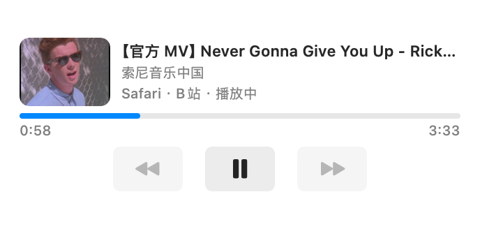

# MediaWidget

适用于 macOS 的原生媒体控制小组件。把它添加到通知中心或桌面，就能查看正在播放的网易云歌曲、哔哩哔哩视频，或 Safari、Chrome 中的 B 站视频。来源提供封面时，小、中、大三种尺寸都能显示真实的专辑封面或视频缩略图。



*中号小组件预览，使用真实 Safari 播放数据和视频封面离屏渲染。*

## 添加小组件

1. 打开 `MediaWidget.app`，让它留在菜单栏。需要生成 App 时，参见[从源码构建](#从源码构建)。
2. 根据下方说明启用你使用的播放器，开始播放歌曲或视频。
3. 点击屏幕右上角日期时间，或用两指从触控板右边缘向左滑，打开通知中心。点击「编辑小组件」，搜索「媒体控制」或「MediaWidget」，选择尺寸。也可以右键单击桌面，选择「编辑小组件」。
4. 按 **⌘⇧M** 打开悬浮面板，在「播放源」里选择要控制的应用或标签页。「自动选择」优先显示正在播放的来源。中号和大号小组件会显示可用进度，拖动进度及调节音量在悬浮面板中进行。

点击媒体标题可打开对应来源。第三方手势工具可以绑定 **⌘⇧M** 或运行 `open 'mediawidget://panel'` 来打开面板。

## 启用播放源

### 网易云音乐和哔哩哔哩客户端

打开 MediaWidget 的「设置 → 播放源与权限」，点「打开辅助功能设置」，为正在使用的 MediaWidget 授权。这使应用能读取和调用播放器自身的控制菜单或按钮。

网易云的歌名和专辑封面来自本地曲目记录。如果设置中显示曲目数据库「无法读取」，点「选择网易云存储文件夹…」。在文件选择器中按 **⌘⇧G**，输入以下路径，选择文件夹后开始播放一首新歌。

```text
~/Library/Containers/com.netease.163music/Data/Documents/storage
```

### Safari 中的 B 站

使用带 App Group 的签名版。打开「Safari → 设置 → 扩展」，启用「MediaWidget · B站」，允许扩展访问 `www.bilibili.com`，然后刷新视频页。

### Chrome 中的 B 站

1. 将 App 放在固定位置，例如「应用程序」。从 MediaWidget「设置 → 播放源与权限」点击「配置 Chrome 扩展」。App 会注册本机通信程序，并在访达中选中 `ChromeExtension` 文件夹。
2. 在 Chrome 打开 `chrome://extensions`，开启「开发者模式」，点击「加载已解压的扩展程序」，选中该文件夹。
3. 打开或刷新 B 站视频页。移动 App 后，重新点击「配置 Chrome 扩展」，再从新位置加载扩展。

两个扩展均支持 `www.bilibili.com/video/…` 和 `www.bilibili.com/bangumi/play/…`。

## 支持情况

| 来源 | 可用信息 | 控制与验证 |
| --- | --- | --- |
| 网易云音乐 | 实测可读取播放状态。歌名、歌手、时长及封面取决于能否读取并关联近期曲目。 | 播放和暂停已实测。上一首、下一首可调用客户端菜单，部分场景未能确认切歌结果。实时进度和独立音量暂不可用。 |
| 哔哩哔哩客户端 | 实测可读取视频标题、进度、时长，并凭 BV 编号取得封面。 | 已用真实视频在面板验证暂停和恢复。拖动进度、独立音量和切换上一项／下一项暂未接入。 |
| Safari、Chrome 的 B 站 | 实测可读取标题、作者、封面、播放状态、进度和视频音量。 | 已实测播放、暂停、跳转进度和调节视频音量。切换分 P 或播放列表暂未接入。Safari 后台标签页可能被系统节流。 |
| Apple Music、Spotify | 提供可选的 AppleScript 适配器，默认关闭。 | 实际播放测试待做。启用时需为对应播放器授予「自动化」权限。 |

- **封面**已用真实 B 站视频验证。中号 Widget 时间线收到了 Safari 和 B 站客户端各自的封面。网易云专辑封面仍待在文件夹授权后复测。
- **小组件按钮**通过 App Intent 把操作发送给当前显示的媒体。1.2.0 已用同一个 Intent 验证 Safari 视频实际暂停，通知中心里的直接点击仍待复测。Widget 状态和封面的刷新由 macOS 调度。
- **音量**在面板中分为系统输出音量和来源独立音量。系统音量取决于输出设备是否开放控制，独立音量取决于播放源。
- **媒体检测**按应用和标签页适配。项目使用 WidgetKit、App Intents、辅助功能、浏览器扩展和 Core Audio，运行时无需调用私有 MediaRemote API。QQ 音乐、IINA、VLC 和 YouTube 暂未接入。

详细实测环境、技术调研及待验证项目见[可行性与验收](docs/verification.md)。

## 从源码构建

需要 Xcode 26.2（Swift 6.2 工具链）和 XcodeGen。工程部署目标为 macOS 14，本机验证环境为 MacBook Air M2，构建与运行记录见[可行性与验收](docs/verification.md)。

```bash
brew install xcodegen
xcodegen generate
open MediaWidget.xcodeproj
```

钥匙串已有 Apple Development 证书时，使用你的开发团队 ID 构建 App、Widget 和 Safari 扩展，让三个目标共享 App Group。

```bash
MEDIA_WIDGET_TEAM=YOUR_TEAM_ID ./build-local.sh
```

产物位于 `build/Build/Products/Release/MediaWidget.app`。直接运行 `./build-local.sh` 可生成 ad-hoc 本地开发版。该版本的 Widget 共享可能受 macOS 容器保护限制，Safari 桥接需要带 App Group 的签名版。

## 隐私

播放状态、封面缓存和控制指令保存在本机。两个浏览器扩展只在上述 B 站视频页运行，无需浏览历史或屏幕录制权限。下载封面时，应用按需访问媒体站点，B 站客户端需要用当前视频的 BV 编号查询封面地址。可在「设置 → 通用 → 封面与刷新」关闭封面下载或整个封面显示。
