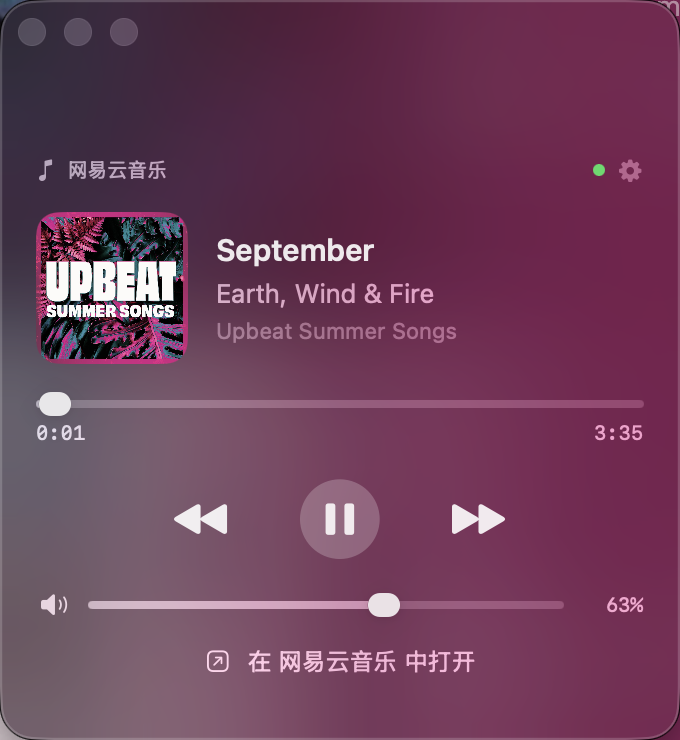
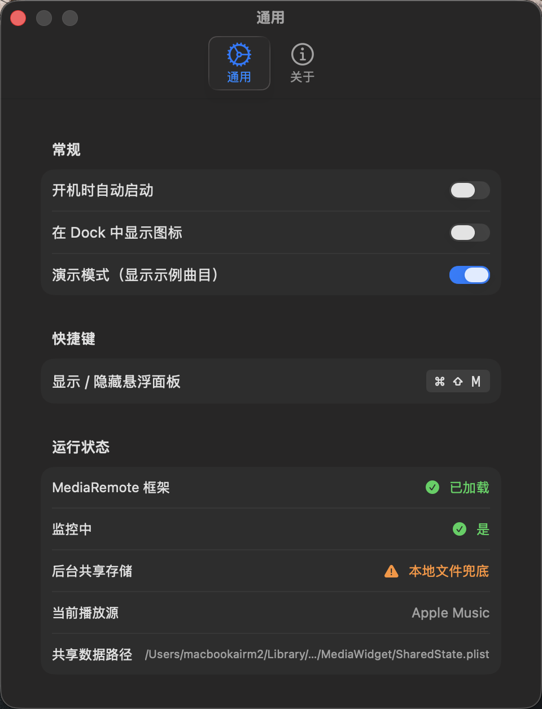

# MediaWidget

> 一个常驻 macOS 菜单栏 / 桌面的流媒体播放状态小组件 —— 实时显示当前在播内容，并提供播放控制。

基于 **SwiftUI + WidgetKit + MediaRemote**，通过私有框架读取系统「正在播放」信息，在主 App 与 Widget 扩展之间共享状态。

当前状态：**可编译、可运行**（Xcode 26.2 / Swift 6 严格并发，macOS 14.0+）。

| 悬浮控制面板（⌘⇧M） | 设置面板 |
|---|---|
|  |  |

---

## ✨ 功能特性

| 模块 | 说明 | 状态 |
|---|---|---|
| 菜单栏常驻 | `MenuBarExtra` 弹出面板，图标随播放状态变化 | ✅ |
| 播放信息展示 | 标题 / 艺术家 / 专辑 / 封面 / 进度 / 音量 | ✅ |
| 播放控制 | 播放·暂停 / 上一曲 / 下一曲 / 拖动进度 / 音量±/静音 | ✅ |
| 悬浮面板 | `⌘⇧M` 呼出毛玻璃浮动窗口，原生红绿灯（可关闭/最小化/缩放）、置顶所有空间、可拖动 | ✅ |
| 多数据源检测 | MediaRemote → AppleScript（Music/Spotify）→ 网易云本地记录，逐级兜底 | ✅ |
| 桌面小组件 | WidgetKit，支持 `.systemSmall / .systemMedium / .systemLarge`，带 AppIntent 控制按钮 | ✅ |
| 设置面板 | 开机自启（`SMAppService`）、Dock 显示、快捷键、运行状态诊断 | ✅ |
| 演示模式 | 无播放器时用示例曲目预览完整 UI（设置内开关） | ✅ |
| 多音源切换 UI | 多个播放器同时在播时自动择「正在播放」者，手动切换 UI 待做 | 🚧 |
| 主题 / 封面开关 | 常量与 Key 已预留 | 🚧 |

### 已知支持的应用

### 数据来源（重要）

**macOS 15.4 起，第三方 App 已无法通过 `MRMediaRemoteGetNowPlayingInfo` 读取「正在播放」**
（本项目在 macOS 26.2 上实测：即使使用真实开发者证书签名，该 API 对任何播放器都返回空）。
因此本项目按下列顺序解析当前播放状态：

| 优先级 | 数据源 | 覆盖 | 说明 |
|---|---|---|---|
| 1 | `MediaRemote` | 全系统 | 老系统 / 有权限时可用，读不到就自动降级 |
| 2 | `ScriptingPlayerSource` | Apple Music、Spotify | AppleScript 读取，含精确播放进度；首次会请求「自动化」权限 |
| 3 | `NeteaseMusicSource` | 网易云音乐 | 读取其本地 SQLite 播放历史（曲名/歌手/专辑/时长/封面），进度按起播时间推算 |

「正在播放」的播放器永远优先于「已暂停」的播放器，所以暂停的 Music 不会盖住正在播的网易云。

---

## 🧱 技术架构

```
┌──────────────────────────┐                          ┌───────────────────────────┐
│   MediaWidget.app        │   共享状态（无需 App Group）│  MediaWidgetExtension     │
│   (菜单栏 / 悬浮面板)     │  ①App Group（若有签名）    │  (WidgetKit 桌面小组件)    │
├──────────────────────────┤ ───────────────────────▶ ├───────────────────────────┤
│ MediaMonitor.shared      │  ②小组件沙盒容器内的        │ TimelineProvider 读取      │
│   ├─ MediaRemoteBridge   │   SharedState.plist       │ MediaIntents              │
│   └─ MediaController     │ ◀──── 播放指令 ────────────│   └─ MediaRemoteBridge    │
└──────────────────────────┘                          └───────────────────────────┘
```

### 目录结构

```
MediaWidget/
├── project.yml                        # XcodeGen 工程定义（唯一工程配置来源）
├── docs/                              # README 截图
├── Shared/                            # 双 target 共享代码
│   ├── MediaInfo.swift                # 核心数据模型（Codable / Sendable）
│   ├── Constants.swift                # App Group、WidgetKind、MediaRemote 指令码
│   ├── SharedDefaults.swift           # 跨进程存储（App Group → 沙盒容器 → 本地文件）
│   └── DemoMedia.swift                # 示例数据 + 程序化生成的演示封面
├── MediaWidget/                       # 主 App target
│   ├── App/
│   │   ├── MediaWidgetApp.swift       # @main，MenuBarExtra + Settings
│   │   └── AppDelegate.swift          # Carbon 全局热键、NSPanel 悬浮窗
│   ├── MediaMonitor/
│   │   ├── MediaMonitor.swift         # 状态中枢（@MainActor 单例 ObservableObject）
│   │   └── MediaRemoteBridge.swift    # 运行期加载私有框架
│   ├── MediaController/               # 播放控制 + AppleScript 兜底
│   ├── Views/                         # MenuBarView / FloatingPanelView
│   ├── Settings/                      # SettingsView + 运行状态诊断
│   └── MediaWidget.entitlements       # 非沙盒
└── MediaWidgetExtension/              # 小组件 target
    ├── Info.plist                     # ⚠️ 必须手写：WidgetKit 需要 NSExtension 字典
    ├── MediaWidgetBundle.swift
    ├── MediaWidget.swift              # StaticConfiguration + TimelineProvider
    ├── MediaIntents.swift             # 播放/暂停、上/下一曲、打开来源 App
    ├── Views/MediaWidgetView.swift    # small / medium / large 三套布局
    └── MediaWidgetExtension.entitlements  # 必须沙盒
```

### 关键技术点

1. **私有框架 MediaRemote**
   不链接任何私有 header，运行时通过 `CFBundleCreate` + `CFBundleGetFunctionPointerForName` 取符号。编译期零依赖，代价是不能上架 App Store。

2. **跨进程数据共享（无需 App Group）**
   Widget 扩展**必须沙盒化**（否则 PlugInKit 直接拒绝注册：*plug-ins must be sandboxed*），沙盒进程只能读自己的容器。因此 `SharedDefaults` 按顺序尝试：
   1. App Group `UserDefaults`（有开发者团队签名时）
   2. 小组件沙盒容器 `~/Library/Containers/com.mediawidget.app.widget/Data/Library/Application Support/MediaWidget/SharedState.plist`
      —— 主 App 未沙盒化，可直接写入该路径；小组件读自己的容器，天然可读
   3. 普通 `~/Library/Application Support/MediaWidget/`

3. **WidgetKit 扩展的 Info.plist 必须手写**
   `NSExtension → NSExtensionPointIdentifier = com.apple.widgetkit-extension` 无法用 `INFOPLIST_KEY_*` 表达，所以该 target 关闭 `GENERATE_INFOPLIST_FILE`。

4. **网易云音乐检测**
   NeteaseMusic 3.x 既不向 MediaRemote 暴露信息，其 Chromium 界面也没有可访问的 AX 树。但它把播放历史写在
   `~/Library/Containers/com.netease.163music/Data/Documents/storage/sqlite_storage.sqlite3` 的
   `historyTracks` 表里（`playtime` + 完整曲目 JSON），本项目直读该表并在本地缓存封面。

5. **时间戳校正**
   播放进度用 `positionTimestamp` + `playbackRate` 外推，避免每秒轮询；仅在播放中启用 5 秒刷新定时器。

6. **Swift 6 严格并发**
   `MediaMonitor` 为 `@MainActor` 单例；`MediaRemoteBridge` 为 `@unchecked Sendable`（初始化后函数指针不可变）；Carbon 回调内用 `MainActor.assumeIsolated`。

---

## 🚀 环境要求

- macOS 14.0+（Sonoma）
- Xcode 16.2+（本项目在 Xcode 26.2 / SDK 26.2 / Swift 6.2 上验证通过）
- [XcodeGen](https://github.com/yonaskolb/XcodeGen)

```bash
brew install xcodegen
```

---

## 🛠 快速开始

```bash
git clone https://github.com/Berlin070777/MediaWidget.git
cd MediaWidget

xcodegen generate     # .xcodeproj 不入库，必须先生成
open MediaWidget.xcodeproj
```

选择 `MediaWidget` scheme → Run。App 只在菜单栏出现（`LSUIElement`）。

命令行构建 / 安装：

```bash
xcodegen generate
xcodebuild -project MediaWidget.xcodeproj -scheme MediaWidget -configuration Release build
cp -R ~/Library/Developer/Xcode/DerivedData/MediaWidget-*/Build/Products/Release/MediaWidget.app /Applications/
```

> 💡 **改了 `project.yml` 或增删了源文件，都要重新执行 `xcodegen generate`**。
> 仓库刻意忽略 `*.xcodeproj/`，避免工程文件与 `project.yml` 不一致导致的 `Multiple commands produce ...swiftmodule` 报错。

### 使用

| 操作 | 说明 |
|---|---|
| 点击菜单栏图标 | 打开控制面板 |
| `⌘ ⇧ M` | 显示 / 隐藏悬浮面板（全局生效） |
| 悬浮面板左上角红绿灯 | 原生 macOS 关闭 / 最小化 / 缩放（关闭只是隐藏，`⌘⇧M` 可再唤出） |
| 面板右上角 ⚙️ | 打开设置 |
| 设置 → 演示模式 | 无播放器时预览完整 UI（示例曲目） |

### 添加桌面小组件

1. 把 App 放到 `/Applications` 并至少运行一次（让系统注册扩展）
2. 右键桌面 → **编辑小组件…**
3. 左侧列表找 **MediaWidget** → 把小组件拖到桌面

### 无开发者账号也能跑

默认配置为 **ad-hoc 签名**（`CODE_SIGN_IDENTITY: "-"`, `DEVELOPMENT_TEAM: ""`），无需任何账号即可编译运行，App Group entitlement 已注释掉，数据共享自动走沙盒容器方案。

发布 / 正式签名时：

1. `project.yml` 中填入 `DEVELOPMENT_TEAM`
2. 打开两份 `.entitlements` 里注释的 `com.apple.security.application-groups`
3. `xcodegen generate` 后自动签名

---

## 🧪 开发调试

```bash
# 演示模式（无需播放器即可看到完整 UI）
defaults write com.mediawidget.app demoMode -bool YES

# 启动即显示悬浮面板
defaults write com.mediawidget.app showPanelOnLaunch -bool YES

# 查看共享状态文件
plutil -p ~/Library/Containers/com.mediawidget.app.widget/Data/Library/Application\ Support/MediaWidget/SharedState.plist
```

---

## 🚧 已知限制

| 限制 | 说明 |
|---|---|
| 不能上架 App Store | 使用私有框架 `MediaRemote`，不受 Apple 支持，系统更新可能导致失效 |
| 首次读取 Music/Spotify 会弹「自动化」权限 | 允许后即可精确读取播放进度；拒绝则只能检测网易云 |
| 小组件需手动添加 | WidgetKit 不允许程序化把小组件放到桌面，首次需按上文手动拖入 |
| ad-hoc 签名无 App Group | 走沙盒容器文件共享；换成正式签名后自动切换到 App Group |
| 多音源切换未做 UI | `allSources` 已采集，UI 待实现 |
| 系统升级风险 | `MediaRemote` 符号名可能变动；`MediaRemoteBridge` 已做 `nil` 保护，失效时只降级不崩溃 |

---

## 🗺 Roadmap

- [x] 修复 Swift 6 并发报错，跑通构建
- [x] 修复小组件不注册（缺 `NSExtension` / 非沙盒）
- [x] 无 App Group 时的跨进程数据共享
- [x] `.systemSmall` 紧凑小组件
- [x] 开机自启改用 `SMAppService`
- [x] MediaRemote 失效后的多数据源兜底（AppleScript + 网易云本地记录）
- [x] 悬浮面板原生红绿灯
- [ ] 多音源切换 UI
- [ ] 主题与封面显示开关落库
- [ ] 歌词 / 音频可视化

---

## ⚠️ 免责声明

本项目使用 **Apple 私有框架 `MediaRemote`** 与 `NSAppleScript` 控制播放，仅用于个人学习与研究，请自行承担使用风险。
媒体元数据与封面版权归各自内容提供方所有。

---

## 📄 License

尚未指定。在补充 LICENSE 前，默认保留所有权利（All rights reserved）。
