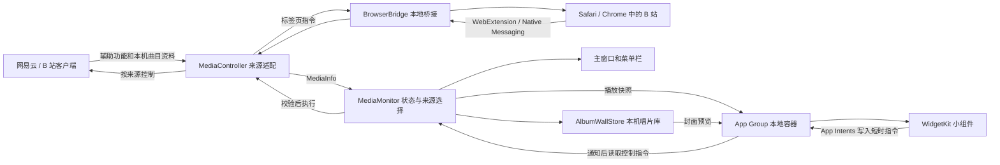

# MediaWidget

MediaWidget 是原生 macOS 媒体工具。用唱片墙浏览最近播放与本机收藏，在桌面或通知中心查看媒体状态，也可以从菜单栏控制网易云音乐、哔哩哔哩客户端和浏览器里的 B 站视频。


*中号小组件的图库预览，使用示例曲目。安装后读取已连接的真实播放源。*

**GitHub `main` 源码版本为 1.5.12。** 1.5.13 和 1.5.14 的本机验证进度见[开发进度](#开发进度)。

[安装](#安装) · [连接播放源](#连接播放源) · [日常使用](#日常使用) · [播放源支持](#播放源支持) · [架构](#架构) · [排查问题](#排查问题) · [许可](#许可)

## 安装

### 环境

- 最低部署目标为 **macOS 14**。实机验证环境为 Apple Silicon MacBook Air M2、macOS 27.2.1、Xcode 26.2 和 XcodeGen 2.46。
- 推荐使用钥匙串中的 **Apple Development** 证书及对应的开发团队 ID 签名。主应用、Widget 和 Safari 扩展会使用同一个 App Group。
- 从源码构建。安装脚本把应用放到 `/Applications/MediaWidget.app`，在应用支持目录保留上一版的应用副本，并重新注册 Widget 和 Safari 扩展。

### 构建并启动

```bash
git clone https://github.com/Berlin070777/MediaWidget.git
cd MediaWidget
brew install xcodegen
MEDIA_WIDGET_TEAM=YOUR_TEAM_ID ./build-local.sh
./install-local.sh
```

把 `YOUR_TEAM_ID` 换成 Xcode「Settings → Accounts」中对应开发团队的 ID。构建产物在 `build/Build/Products/Release/MediaWidget.app`。安装后用「应用程序」里的版本授权与使用。

只调试主应用时，可以直接运行 `./build-local.sh` 生成 ad-hoc 签名版。它使用开发回退容器，小组件共享状态可能受 macOS 容器权限限制。Safari 桥接需要带 App Group 的开发签名版。

## 连接播放源

在菜单栏点 MediaWidget 图标，打开齿轮菜单中的「播放源与权限」。只配置自己使用的来源。

| 来源 | 设置步骤 |
| --- | --- |
| **网易云音乐** | 在「辅助功能」中授权已安装的 MediaWidget。回到应用设置，点「连接网易云曲目信息」。需要手动选目录时，打开 `~/Library/Containers/com.netease.163music/Data/Documents/storage`，确认「曲目数据库」显示「可读取」。 |
| **哔哩哔哩 macOS 客户端** | 授予同一个 MediaWidget「辅助功能」权限，然后在客户端打开视频。 |
| **Safari 中的 B 站** | 在「Safari → 设置 → 扩展」启用「MediaWidget · B站」，允许访问 `www.bilibili.com`，重新加载视频页。 |
| **Chrome 中的 B 站** | 先安装到「应用程序」。在 MediaWidget 设置中点「配置 Chrome 扩展」，随后在 `chrome://extensions` 开启开发者模式，点「加载已解压的扩展程序」，选中应用打开的 `ChromeExtension` 文件夹。重新加载视频页。 |
| **Apple Music / Spotify** | 在「其他播放器」中开启可选适配器，按系统提示授予自动化权限。属于实验性支持。 |

两个浏览器扩展在 `https://www.bilibili.com/video/…` 和 `https://www.bilibili.com/bangumi/play/…` 注入媒体脚本。同一浏览器内的多个视频标签页可分别出现在来源列表。

## 日常使用

### 唱片墙

打开应用后，从系统菜单栏的「唱片墙」菜单切换「最近播放」「我的收藏」和「立体翻阅」「封面网格」。最近播放最多保留 40 张专辑。收藏独立保留，可单独从最近播放移除某一张。

| 操作 | 方式 |
| --- | --- |
| 打开唱片墙 | MediaWidget 前台按 **⌘1**，或点菜单栏应用中的「唱片墙」。 |
| 搜索专辑 | **⌘F**，输入专辑名或艺人的片段。最近播放和收藏一起搜索。点击结果，或用方向键选择后按回车，即可定位。 |
| 定位正在播放的专辑 | **⌘⇧F**。当前播放源正在播放且专辑已收录时可用。目标位于另一分组时自动切换。 |
| 横向翻阅 | 立体视图中双指左右滑动，或按 **← / →**。两张及以上的封面首尾循环。 |
| 翻到背面 | 双指上滑或下滑。慢滑时封面跟手，同方向再滑一次回到另一面。 |
| 查看详情或播放 | 点中央封面打开详情。右键可收藏、移除最近记录或在网易云后台播放专辑。公开版详情可点播本机已识别的已播曲目。 |

底栏显示上一首、播放／暂停、下一首和进度。曲目可跳转时可拖动滑块。翻到背面可查询发行版背封，成功后缓存在本机。右键背面可查看记录的图源、重试或导入图片。缺少实体扫描图时会显示缺图状态。

### 通知中心、桌面和菜单栏

打开通知中心底部的「编辑小组件」，或在桌面右键进入组件图库。

| 小组件 | 尺寸 | 用途 |
| --- | --- | --- |
| **媒体控制** | 小、中、大 | 查看当前来源、标题、封面和播放状态，按来源能力显示控制按钮。中、大号显示已播时间和总时长。 |
| **唱片墙** | 小、中 | 浏览最近播放或收藏的封面，点按打开应用里的完整唱片墙。 |

- 点媒体小组件左上角的来源按钮，选择播放器或视频标签页。切回「自动选择」恢复自动跟随。
- 点「调整进度」进入应用窗口拖动进度。系统音量和支持的媒体音量也在应用的媒体控制页调整。
- 从应用前台按 **⌘2** 打开媒体控制。脚本也可使用 `open 'mediawidget://panel'`、`open 'mediawidget://sources'` 或 `open 'mediawidget://albums'`。
- 关闭主窗口后，菜单栏应用会继续监控。可在「通用」开启登录时启动。小组件更新时间由 macOS 调度。

## 播放源支持

下表以已覆盖的客户端与实机记录为准。具体按钮由当前媒体条目的能力决定。

| 来源 | 读取 | 控制与已知边界 |
| --- | --- | --- |
| **网易云音乐** | 曲名、艺人、专辑、封面、播放状态、进度与时长。曲目资料需要本机数据库授权。 | 播放／暂停、上一首、下一首。3.1.12（构建 3444）的普通窗口已验证拖动进度，包括最小化窗口。其他构建、迷你模式和全屏下的拖动暂未开放。整张专辑及单曲后台播放依赖网易云编号和客户端反馈。 |
| **哔哩哔哩客户端** | 视频标题、进度、时长和可用封面。 | 1.17.1 普通窗口已验证通知中心播放／暂停。暂未接入客户端拖动进度和独立音量。全屏或控件暂时隐藏时可能暂时识别不到。 |
| **Safari / Chrome 中的 B 站** | 视频标题、作者、封面、播放状态、进度、时长和网页视频音量。 | 已验证播放／暂停、拖动进度和调节视频音量。当前不切换分 P 或播放列表。Safari 后台标签页可能出现更新延迟。 |
| **Apple Music / Spotify** | 可选 AppleScript 适配器。 | 取决于播放器脚本支持与授权，实际播放仍待实机验证。 |
| **系统输出** | Core Audio 读取当前输出设备的音量与静音状态。 | 调整能力取决于设备支持。网易云和 B 站客户端暂未接入单独的媒体音量。 |

详细历史测试见[可行性与验收](docs/verification.md)，后续修复与版本边界见[变更记录](docs/changelog.md)。

## 架构

主应用通过各来源适配器获取状态，并统一为 `MediaInfo`。应用和组件共享的是短时快照与指令，播放器仍负责自己的播放状态。系统生命周期事件会触发刷新，普通检测由可调低频轮询补充。



| 模块 | 职责 |
| --- | --- |
| [MediaWidget/App](MediaWidget/App)、[MediaWidget/Views](MediaWidget/Views) | SwiftUI 与 AppKit 主窗口、菜单栏、应用菜单、媒体控制和 `mediawidget://` 导航。 |
| [MediaWidget/MediaMonitor](MediaWidget/MediaMonitor)、[MediaWidget/MediaController](MediaWidget/MediaController) | 读取及归一化播放器和标签页状态、维护来源能力、执行控制并刷新快照。 |
| [MediaWidget/AlbumWall](MediaWidget/AlbumWall) | 本机唱片库、前后封面缓存、收藏与搜索、触控板与键盘翻阅、专辑详情。 |
| [Shared](Shared)、[MediaWidgetExtension](MediaWidgetExtension) | 跨目标共享数据模型和 App Group 存储。两个 WidgetKit 小组件消费快照，其中媒体小组件通过 App Intents 发出指令。 |
| [BrowserExtension](BrowserExtension)、[SafariExtension](SafariExtension)、[ChromeNativeHost](ChromeNativeHost) | 按标签页读取网页视频与 Media Session 信息，并通过 Safari 原生扩展或 Chrome Native Messaging 传回本机。 |

点击组件按钮时，指令带有来源与媒体条目标识。App Intents 将指令写入 App Group，由 Darwin 通知提示主应用读取。主应用会确认目标、能力和时效仍然匹配，避免切源后对另一个播放器误发指令。Safari 在签名的 App Group 内共享桥接状态，Chrome 通过本机 Native Host 转达。

## 隐私和权限

- 唱片搜索、最近播放、收藏、封面缓存、播放快照和指令在本机处理。唱片库位于 `~/Library/Application Support/MediaWidget/AlbumWall`。
- 记录最近播放可在「唱片墙」菜单关闭或清除。清除记录会保留已收藏的专辑。
- 启用在线封面下载后，媒体源提供封面 URL 时会按需下载。B 站客户端可使用视频编号获取封面，唱片翻面时可能向 MusicBrainz 查询专辑名和艺人，背封图源可从右键菜单查看。
- 网易云存储以只读方式打开。客户端控制需要辅助功能授权，可选的脚本播放器使用 macOS 自动化授权。浏览器扩展使用 Native Messaging，只在上述 B 站播放路径注入媒体脚本。
- 应用通过公开 macOS 框架和独立播放器适配器集成。系统全局媒体会话枚举不在当前实现里。

## 排查问题

| 现象 | 检查方法 |
| --- | --- |
| 网易云显示「曲目信息不可用」 | 在「系统设置 → 隐私与安全性 → 文件与文件夹」确认授权，或重新选择网易云的存储目录。随后在 MediaWidget 设置中点「重新检测曲目数据库」。 |
| 切歌后没封面 | 核对设置中的「显示封面」与在线下载开关。切歌时会根据曲目编号等候对应资料，封面缺失时显示占位。 |
| 小组件状态不更新或按钮无效 | 先在菜单栏确认应用正在运行且能控制同一来源。确认设置中「共享状态」为 App Group。覆盖安装后可用 `./install-local.sh` 重新注册扩展并再打开通知中心。 |
| 网易云拖动进度无效 | 核对客户端版本和普通窗口模式。跳转可能短暂唤起窗口，切歌或窗口目标无法验证时会放弃跳转。 |
| 点播失败或背封缺失 | 点播需有效的网易云编号及客户端权限。背封依赖发行版扫描资料，可右键查看来源、重试或导入图片。 |

## 开发与验证

`project.yml` 定义主应用、Widget 扩展、Safari 扩展和 Chrome Native Host 四个目标。用 XcodeGen 生成工程，选择 `MediaWidget` scheme 构建。

```bash
xcodegen generate
open MediaWidget.xcodeproj

# 检查构建产物签名和本机已注册的扩展
codesign --verify --deep --strict build/Build/Products/Release/MediaWidget.app
pluginkit -m -i com.mediawidget.app.widget
pluginkit -m -i com.mediawidget.app.safari

# 在 Apple Silicon 上生成小组件布局预览和运行布局断言
./tools/widget-preview/run.sh
```

预览工具将产物写入 `/tmp/mwpreview`。预览用于检查布局。播放器状态、控件是否生效、组件刷新和浏览器权限需要分开实测。提交问题时建议附上 macOS、MediaWidget 与播放源版本，以及实际操作路径。

## 开发进度

| 版本 | 验证状态 |
| --- | --- |
| **1.5.12** | GitHub `main` 可构建的公开版本。支持按专辑或艺人搜索、定位正在播放的已收录专辑和循环翻阅。 |
| **1.5.13** | 本机开发版。搜索结果关闭后沿最短方向连续滑到目标，支持触控板接管。远距离定位和循环翻阅已用 40 张唱片验证。 |
| **1.5.14** | 本机开发版。专辑详情从 MusicBrainz 补齐发行版曲序、分碟和时长，成功后本机缓存。已用三张专辑验证完整曲序及离线读取。拥有可靠网易云编号的行才有后台点播入口。无编号曲目可浏览，网易云客户端负责最终播放许可。 |

1.5.13 和 1.5.14 的对应源码目前在本机开发工作区。从本仓库构建请以 `main` 的版本为准。

## 许可

源码采用 [MIT 许可证](LICENSE)。第三方唱片封面、视频画面与品牌素材的权利归各自权利人所有。
